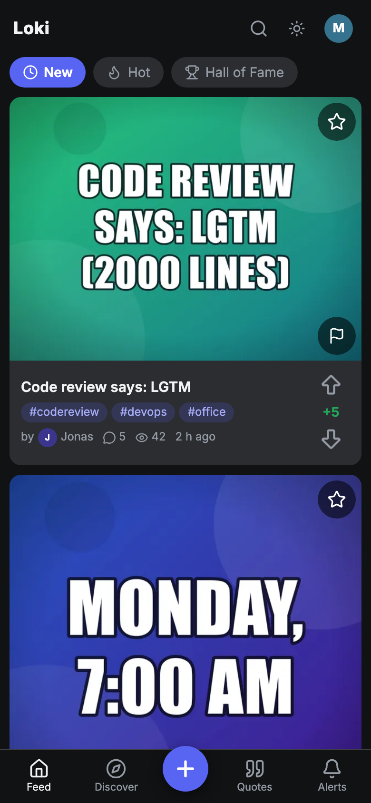
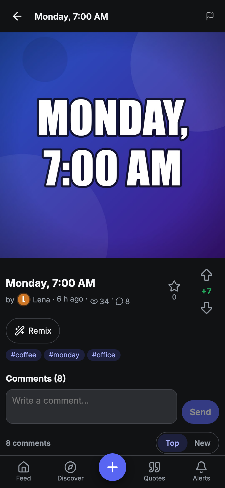
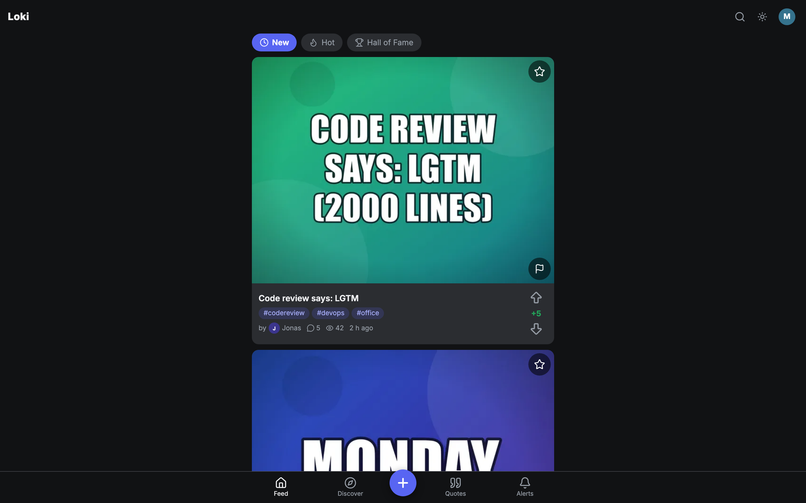

# Loki

Loki is a meme board for one team and nobody else. It is built for 25–50 people who want to post, vote on and argue about work-and-industry memes from their phones, without any of it ever being publicly reachable. It is a ground-up rewrite of MemeLord, a Django fork the team outgrew, and is named after the god of mischief.

## Features

Planned and being built. The UI is German; code and docs are English.

- **Card feed** with in-feed voting, comment counts and hashtag chips. Views for New, Hot and Hall of Fame.
- **Entdecken**: fullscreen swipe through memes you have not seen yet, then random old gems.
- **Comments**, **favorites** and swipe-between-memes in the detail view.
- **Trending** via a periodically recomputed hot score, plus the **Hall of Fame**.
- **Quotes** page with its own voting and submission form.
- **Tags** with autocomplete and hashtag filtering.
- **NSFW and spoiler blur**, set at upload or by moderators.
- **Statistics**: uploads over time, top uploaders and voters, tag distribution.
- **Meldungen und Moderation**: members report memes, comments and quotes. Content with too many open reports is hidden until a moderator decides in the moderation area (queue, timeouts, audit log).
- **Rules and FAQ**, editable by admins in the app.
- **PWA** with a share target, so memes can be sent straight from the share sheet.

## Screenshots

<p align="center">
  
  
</p>

<p align="center">
  
</p>

## Security model

- Sign-in is Authentik OIDC only. Access is gated on group membership; a valid Authentik login alone is not enough. Member, moderator and admin roles come from groups.
- Every route requires a session, except login and health checks.
- Every media file sits behind auth too. The storage bucket is never public, and there is no configuration option that makes it so.
- Backups of the database and media are encrypted and go to a separate bucket.

## Tech stack

- SvelteKit 3 (Svelte 5) with TypeScript
- PostgreSQL via Drizzle ORM
- S3-compatible storage: Cloudflare R2 in production, MinIO in development
- Docker (Compose), self-hosted
- GitHub Actions building images to GHCR

## Status

> ⚠️ **Early development.** Scaffold and dev environment are done (Task 1 of 20). Nothing is deployable yet.

The roadmap is the task list in [`docs/superpowers/plans/2026-10-20-loki.md`](docs/superpowers/plans/2026-10-20-loki.md).

## Development quickstart

Requires Node and Docker.

```sh
cp .env.dev.example .env
docker compose -f docker-compose.dev.yml up -d   # Postgres, MinIO, mock OIDC provider
npm install
npm run dev
```

Run the tests with `npm test`. `.env.dev.example` is the development template; `.env.example` is the production one (see [`docs/deployment.md`](docs/deployment.md)).

For the full design (goals, non-goals, decisions, security, operations), see [`docs/superpowers/specs/`](docs/superpowers/specs/).
